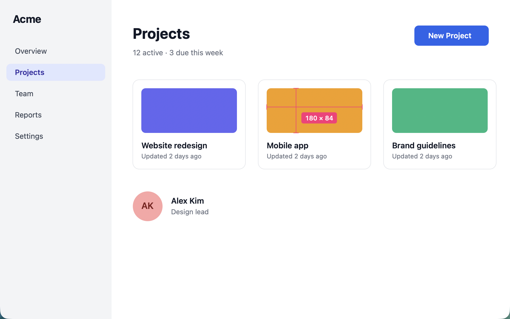
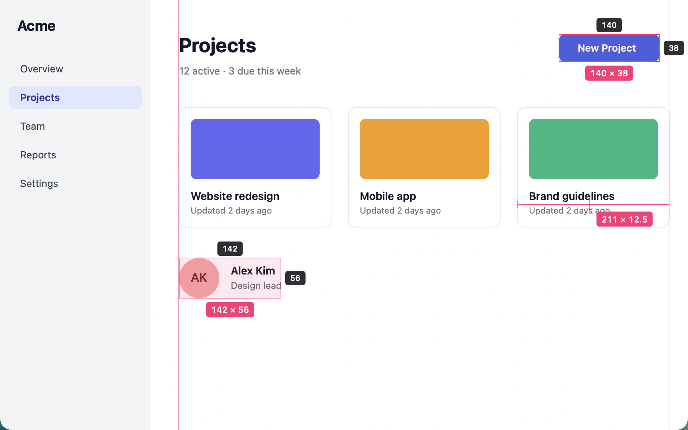
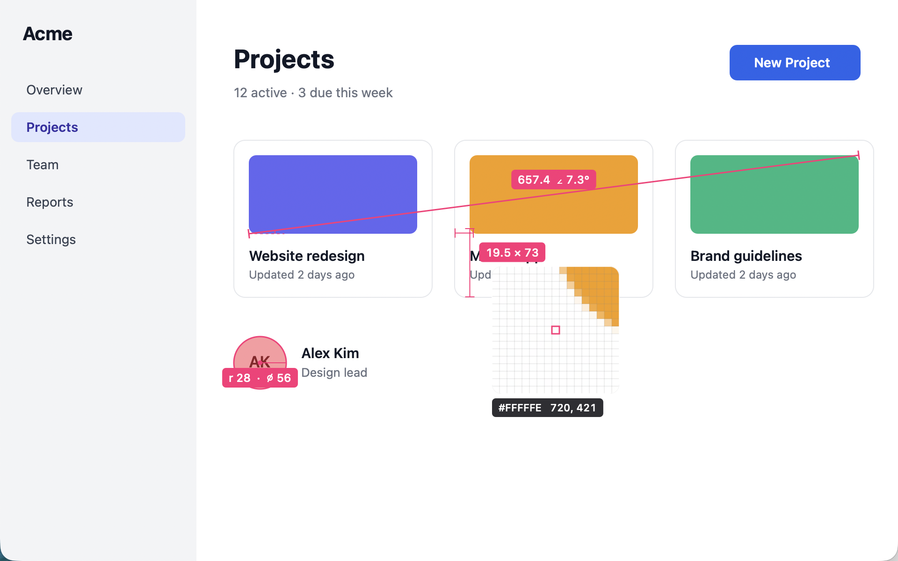
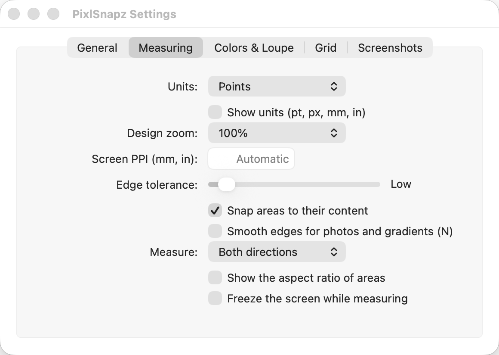

# PixlSnapz

Measure anything on your screen. PixlSnapz is a native macOS screen ruler written in Rust, inspired by [PixelSnap](https://pixelsnap.com): press a shortcut, move the pointer, and see the distances to the nearest edges in every direction. Drag over a button, an icon, or a block of text and the box snaps to its exact bounds.

Everything happens on your Mac: no accounts and no telemetry. The only network access is checking for updates, which you can turn off.

Apple silicon, macOS 14 Sonoma or later.



<p align="center">
  
  
</p>

<p align="center">
  
</p>

<sub>Screenshots use a made-up demo window; `scripts/readme_screenshots.sh` regenerates them.</sub>

## Features

- **Distances**: lines run from the pointer to the nearest edge left, right, up, and down, with the size as `W × H`; the pointer itself is hidden while measuring, so nothing covers the spot the lines cross
- **Area snapping**: drag over something and the box shrinks to its exact bounds; several objects in one drag snap to all of them. Hold ⌘ (or drag with the right mouse button) to measure exactly what you drag
- **Keep measurements**: click to keep a distance on screen, and drag as many areas as you like. New distances stop at kept areas and guides, so you can read the gap between two objects
- **Guides**: press V or H for a vertical or horizontal guide at the pointer; guides snap to nearby edges, show the distances between each other and to the screen edges, and move with the arrow keys
- **Line ruler**: ⌥-drag (or press L for the line tool) to measure the length and angle of any line, with a protractor arc; hold ⇧ to snap to 45°
- **Circle tool**: press E and drag from the center to measure radius and diameter
- **Jump to the next edge**: ⌥ plus an arrow key moves the pointer just past the next edge, object by object
- **One direction at a time**: press X to measure only horizontally or only vertically
- **Crosshair**: hold ⇧ for lines across the whole screen, to check alignment
- **Loupe**: a pixel grid magnifier next to the pointer, with the color and coordinates of the pixel under it; zoom from 4× to 32× with - and +
- **Colors**: P copies the color under the pointer and ⌥P the average color of the last area, as hex, `rgb()`, `hsl()`, SwiftUI, or AppKit code (⇧P switches); the last 20 are under Recent Colors in the menu bar icon's menu
- **Color vision**: ⇧Z shows the loupe as people with protanopia, deuteranopia, tritanopia, or achromatopsia see it
- **Screenshots**: ⌘S saves the last area as a PNG on the Desktop (⇧⌘C copies it), with the measurements drawn in (M turns that off); hold ⌥ for padding around it
- **Freeze screen**: measure a still copy of the screen, so menus and animations stay put
- **Contrast checker**: press K on one color and K again on another to copy the WCAG contrast ratio and grade, such as `4.54:1  AA`; a live readout with both swatches follows the pointer in between
- **Units**: points, pixels, millimeters, or inches (real sizes from what each display reports, or a PPI you set), optional unit labels, and the aspect ratio of areas (`16:9`)
- **Design zoom**: measure a design shown at 200% (or 25% to 400%) in its own units; D and ⇧D change it while measuring
- **Grids**: press O for a square grid or a column layout grid (columns, gutter, and margin are adjustable), over the whole screen or inside the last area
- **Keep on screen**: press B to stop measuring but leave the measurements up while you keep working; clicks go through them, and the next measuring session picks them up again
- **Settings window** with every option in tabs, and a shortcut recorder
- **Adjustable edge tolerance** for shadows, gradients, and low-contrast edges: scroll, or press [ and ]
- **Smooth edges** (N) for photos, compressed images, and gradients
- **Restore** the measurements and guides of the previous session (R), even after a restart
- Multiple displays with different scales, including over full-screen apps
- Six guide colors, launch at login, and a customizable global shortcut that can be turned off in chosen apps (such as a design tool that uses it), from the menu bar icon's menu or Settings

## Install

With [Homebrew](https://brew.sh):

```sh
brew install --cask houseofmackee/tap/pixlsnapz
```

This also links the `pixlsnapz` command line tool. PixlSnapz updates itself, so `brew upgrade` leaves it alone (`brew upgrade --cask --greedy pixlsnapz` updates it through Homebrew instead), and `brew uninstall --zap --cask pixlsnapz` also removes its settings.

Or download `PixlSnapz-<version>-arm64.dmg` from the [releases page](https://github.com/houseofmackee/pixlsnapz/releases/latest), open it, and drag PixlSnapz into Applications. Check it against `SHA256SUMS.txt` from the same release if you like (`shasum -a 256 -c --ignore-missing SHA256SUMS.txt`).

PixlSnapz lives in the menu bar. The first time you measure, macOS asks to allow **Screen Recording**: PixlSnapz looks at the pixels on screen to find edges. Turn it on in System Settings > Privacy & Security > Screen & System Audio Recording, then quit and reopen PixlSnapz. Nothing is saved or sent anywhere, except screenshots you save yourself.

## Languages

PixlSnapz is in English, German, French, and Spanish, following the language set in System Settings > General > Language & Region (also per app). Measurements, color codes, and everything copied to the clipboard stay as they are, in any language.

## Accessibility

- VoiceOver reads every Settings control by its name, announces what happens while measuring (each kept measurement, copies, and mode changes, such as "Kept 140 by 38"), and can read the measurement under the pointer on request (the overlay's value).
- With **Increase Contrast** or **Reduce Transparency** on (System Settings > Accessibility > Display), lines are twice as thick and labels are opaque with an outline.
- Every action has a keyboard shortcut, and the overlay never animates.

## Updates

From 0.1.1 on, PixlSnapz updates itself with [Sparkle](https://sparkle-project.org): choose **Check for Updates…** in the menu bar icon's menu (it reads **Update to PixlSnapz X…** when a newer version was found), and turn automatic checks on or off in Settings > General. Updates are signed with PixlSnapz's own EdDSA key and the same Developer ID, so they install without warnings and keep the Screen Recording permission. New releases are published as pre-releases first; the update feed is the latest regular release's `appcast.xml`. Checking for updates contacts github.com and nothing else.

## Usage

Press **⇧⌘1** (or choose Measure from the menu bar icon), measure, and press **Esc** when done.

| Key | Action |
| --- | --- |
| Move | Distances to the nearest edges |
| Drag | Measure an area, snapped to its content |
| ⌘ drag, right-drag | Measure an area without snapping |
| ⌥ drag | Measure a line: length and angle |
| L | Line tool on or off (drag draws lines) |
| E | Circle tool on or off (drag from the center) |
| ⇧ while dragging | Square area, or a line at a multiple of 45° |
| Space while dragging | Move the area |
| Click | Keep the distances at that point |
| ⇧ (hold) | Crosshair across the whole screen |
| V / H | Add a vertical / horizontal guide (arrow keys then move it) |
| G | Remove all guides |
| Arrow keys | Move the pointer by one pixel (⇧: ten points) |
| ⌥ arrow keys | Jump to the next edge |
| X | Measure both directions, horizontal only, or vertical only |
| ⌘C | Copy the last size, such as `120 × 48` |
| Return | Copy the last size and finish |
| P | Copy the color under the pointer |
| ⌥P | Copy the average color of the last area |
| ⇧P | Switch the color format: hex, RGB, HSL, SwiftUI, AppKit |
| ⌘S / ⇧⌘C | Save / copy a screenshot of the last area (⌥: with padding) |
| M | Measurements in screenshots on or off |
| Z | Loupe on or off |
| - and + | Loupe zoom out and in |
| ⇧Z | Loupe color vision: normal, protanopia, deuteranopia, tritanopia, achromatopsia |
| F | Freeze screen on or off |
| U | Points, pixels, millimeters, inches |
| A | Aspect ratio on or off |
| K | Contrast: pick the first color, then compare and copy |
| O | Grid: off, square, columns |
| B | Keep the measurements on screen and stop measuring |
| S | Snapping on or off |
| Scroll, [ and ] | Lower or raise the edge tolerance |
| N | Smooth edges on or off (photos and gradients) |
| D and ⇧D | Design zoom up and down |
| ⌫, ⌘Z | Remove the last measurement or guide |
| C | Clear everything |
| R | Restore the previous session, also after a restart |
| ? | Show or hide the shortcut hints |
| Esc, right click | Finish |

From a script or a launcher such as Raycast or Alfred, `PixlSnapz.app/Contents/MacOS/pixlsnapz measure` starts measuring in the running app, and `pixlsnapz settings` opens Settings.

Measurements kept on screen with B stay until you measure again (they come back for editing) or choose Clear Kept Measurements in the menu bar icon's menu.

## Settings

Choose **Settings…** (⌘,) in the menu bar icon's menu for every option, in five tabs (General, Measuring, Colors & Loupe, Grid, Screenshots), including recording a new shortcut; the menu itself has the common ones. Everything is saved in `~/Library/Application Support/PixlSnapz/settings.toml` (Open Settings File in the Settings window), and changes made there by hand apply the next time you measure or open the menu.

```toml
shortcut = "shift+cmd+1"     # modifiers: cmd, shift, opt, ctrl; keys: a to z, 0 to 9, f1 to f12, punctuation, space
units = "points"             # or "pixels", "millimeters", "inches"
tolerance = 8                # 0 to 255; how different a color must be to count as an edge
snap_areas = true
show_hints = true
loupe = false
color = "#FF2D78"            # guide color
show_units = false
show_aspect_ratio = false
freeze = false
screenshot_folder = ""       # empty for the Desktop; "~/Pictures/Measurements" works too
axes = "both"                # or "horizontal", "vertical"
color_format = "hex"         # or "rgb", "hsl", "swiftui", "appkit"
loupe_zoom = 8               # 4, 6, 8, 12, 16, 24, or 32
design_zoom = 100            # percent; lengths are divided by it
screen_ppi = 0.0             # 0 uses the size each display reports
grid = "off"                 # or "square", "columns"
grid_size = 8.0              # points
grid_columns = 12
grid_gutter = 20.0           # points
grid_margin = 0.0            # points
stamp_screenshots = true     # draw the measurements into screenshots
smooth_edges = false         # find edges on a smoothed screen (photos, gradients)
vision = "normal"            # or "protanopia", "deuteranopia", "tritanopia", "achromatopsia"
disabled_apps = []           # bundle identifiers, such as ["com.figma.Desktop"]
```

The last session's measurements and guides are kept in `last-session.toml` next to the settings, for R, and recent colors in `colors.toml`.

## Build and run

Requires an Apple silicon Mac with macOS 14 or later and a Rust toolchain.

```sh
cargo run --release            # run from the terminal (Screen Recording then applies to your terminal)
scripts/bundle.sh              # build and sign dist/PixlSnapz.app (Developer ID if present; see scripts/lib.sh)
scripts/make_dmg.sh            # build dist/PixlSnapz-<version>-arm64.dmg and its .sha256, then mount and check it
scripts/dist.sh                # make_dmg.sh, plus a zip and SHA256SUMS.txt: everything a release uploads
scripts/make_icon.sh           # rebuild macos/AppIcon.icns after editing macos/AppIcon.svg (needs librsvg)
open dist/PixlSnapz.app
```

To try a translation, start the app with `-AppleLanguages "(de)"` (or `fr`, `es`). Environment variables for testing: `PIXLSNAPZ_HOME` uses a different settings folder, `PIXLSNAPZ_LOG=pixlsnapz=debug` enables verbose logging, and `PIXLSNAPZ_SHOW_SETTINGS=<tab>` (such as `measuring`) opens Settings at that tab on launch.

## Development

```sh
cargo test                     # unit tests, plus UI tests that build the real Settings window and render measurements (tests/)
cargo clippy --all-targets
scripts/readme_screenshots.sh  # regenerate docs/screenshots from a demo window (needs cliclick and Accessibility for the terminal)
python3 -I scripts/strings.py  # update the translators' template after changing user-facing text (--check: CI's check)
```

The edge detection (`src/measure.rs`), units (`src/units.rs`), and geometry (`src/geometry.rs`) work on plain numbers and RGBA buffers with no AppKit dependency, so they are fully unit tested. Two UI tests run without the test harness, because AppKit needs the main thread: `tests/settings_layout.rs` builds the real Settings window in every language and checks that no control overlaps another, leaves its tab, or has its text cut off, that VoiceOver can name every control, and that each tab's content matches `tests/snapshots/settings_layout.txt` (after an intended change, review the diff and run `UPDATE_SNAPSHOTS=1 cargo test --test settings_layout`); `tests/overlay_render.rs` renders kept measurements over a made-up screenshot and checks the pixels where outlines, labels, guides, lines, and circles must be, also in high contrast. The rest is AppKit through `objc2`, in the library too so the UI tests can build it (`src/main.rs` is only the command line):

- `src/capture.rs` takes a screenshot of each display with ScreenCaptureKit.
- `src/overlay/` shows one transparent, non-activating panel per display: `mod.rs` (starting and ending a session, accessibility), `view.rs` (window, view, and mouse input), `session.rs` (session state and logic), `keys.rs` (keyboard commands), `actions.rs` (copying, contrast, and screenshots), `draw.rs` (drawing), and `loupe.rs` (the magnifier).
- `src/settings_window/` is the Settings window (`mod.rs`), its shortcut recorder (`recorder.rs`), and its app and folder pickers (`pickers.rs`).
- `src/app/` owns the menu bar item, the global shortcut (Carbon `RegisterEventHotKey`, which needs no extra permission), and alerts (`mod.rs`), and the menu (`menu.rs`).
- `src/updates.rs` loads Sparkle at runtime.
- `src/i18n.rs` translates text: `t!("…")` for literals (with named `{placeholders}`), `n!("…")` for names translated where shown. The menu, Settings, and alert helpers translate the titles passed to them. `scripts/strings.py` collects all of it into `macos/en.lproj/Localizable.strings`, the template; translations are `macos/<language>.lproj/Localizable.strings` (plus `InfoPlist.strings` for the Screen Recording prompt). To add a language, copy the template there, translate the values, add the language to `CFBundleLocalizations` in `macos/Info.plist`, and run the checks: the Settings layout test also checks every translation for cut-off text.

GitHub Actions runs `cargo fmt --check`, `cargo clippy -D warnings` (debug and release), `cargo test`, a bundle build, and `cargo deny check` on every push to main and every pull request.

### Releasing

Releases are built and published by GitHub Actions. Move the Unreleased notes in [CHANGELOG.md](CHANGELOG.md) into a section for the new version, bump the version in `Cargo.toml` (and `CFBundleVersion` in `macos/Info.plist`), commit, then push a matching tag:

```sh
git tag vX.Y.Z && git push origin main vX.Y.Z
```

`.github/workflows/release.yml` checks the tag matches `Cargo.toml`, signs with the Developer ID from the repository secrets `DEVELOPER_ID_P12_BASE64` and `DEVELOPER_ID_P12_PASSWORD`, notarizes the app and the DMG with the App Store Connect API key (`NOTARY_API_KEY_BASE64` secret; `APPLE_TEAM_ID`, `NOTARY_KEY_ID`, and `NOTARY_ISSUER_ID` variables), refuses to publish anything Gatekeeper would block, writes the update feed `appcast.xml` signed with the `SPARKLE_PRIVATE_KEY` secret (the EdDSA key in the login Keychain, account `pixlsnapz`; its public half is `SUPublicEDKey` in `macos/Info.plist`), and publishes the DMG, zip, `SHA256SUMS.txt`, and `appcast.xml` as a pre-release. Mark it as a regular release once the checks in [docs/RELEASE_CHECKLIST.md](docs/RELEASE_CHECKLIST.md) are done.

## License

Licensed under either of [Apache License 2.0](LICENSE-APACHE) or [MIT license](LICENSE-MIT) at your option.
